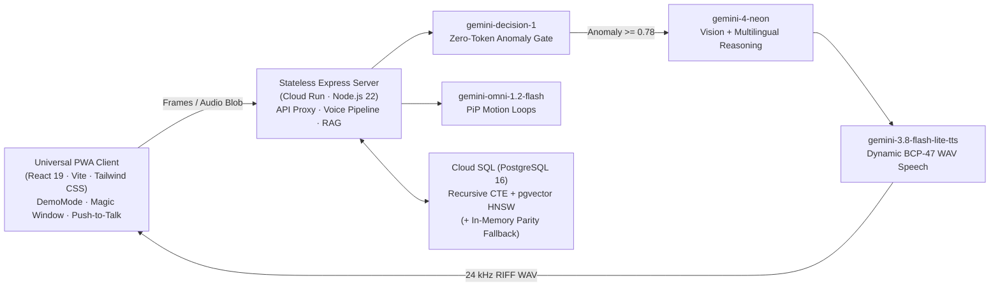

# Jack of All Trades

**Open-Source Multimodal Visual Repair & Physical Assembly Assistant (PWA)**

[](./LICENSE)
[](https://nodejs.org/)
[](https://react.dev/)
[](./schema.sql)

**Jack of All Trades** is an AGPL-3.0 Progressive Web App that turns any smartphone or tablet camera into a real-time, voice-enabled visual mechanic and assembly guide. Designed with a distraction-free **Magic Window** camera interface for non-technical users and backed by a zero-token decision routing pipeline, multilingual two-way audio, and a PostgreSQL `pgvector` physical ontology graph, it helps users identify hardware parts, follow step-by-step repair instructions, and avoid costly mistakes or unnecessary product returns.

---

## Key Capabilities

- **Magic Window Live Camera UI** — Full-screen rear-facing viewfinder (`MediaDevices` API) with hardware torch/screen-fill flashlight control, **Scan Problem** analysis, and zero cluttered telemetry.
- **Voice-Guided Interactive Onboarding Demo** — First-time visitors experience a safe, interactive battery-latch walkthrough with automated neural voice narration (`GET /api/demo-narration`) synchronized step-by-step with visual highlights and animated motion cues.
- **Native Two-Way Multilingual Voice Assist** — Press and hold **Hold to Explain** to capture raw microphone audio (`MediaRecorder`) alongside live visual frames. The backend detects the user's spoken language automatically and replies aloud in the exact same language (under 3 direct, actionable sentences) as a binary 24 kHz RIFF WAV stream.
- **Zero-Token Decision Routing (ADR 003)** — Client-side stillness gating and `gemini-decision-1` (`v1beta` Decisions API, `0` output tokens) filter nominal frames and escalate to `gemini-4-neon` only on high-confidence anomalies (`>= 0.78`), reducing compute cost and preventing mobile thermal throttling.
- **Scale Anchor Guard (Break 2 Invariant)** — Prevents tool-size hallucinations by redacting exact metric/imperial tool specifications unless WebXR depth or a physical scale anchor (US quarter, credit card, or thumb reference) is present.
- **PostgreSQL Recursive CTE + `pgvector` Ontology RAG (ADR 001)** — Models hardware assemblies, fastener confusion edges, and 768-dimensional visual embeddings in PostgreSQL 16 (`pgvector` HNSW). User bounding-box corrections update embeddings immediately without model retraining, with an automatic in-memory parity engine when offline.
- **On-the-Fly Picture-in-Picture Motion Clips** — Generates short hand-motion guidance loops via `gemini-omni-1.2-flash` (`POST /api/generate-pip`) for complex mechanical gestures.
- **Built-In Admin & Operations Platform (`/admin`)** — Live system health monitoring, Cloud SQL diagnostics, Scale Anchor Guard tester, Ontology RAG explorer, architecture diagrams, corresponding source downloads, and QA runbook.

---

## System Architecture



### AI Model Stack (`@google/genai`)

| Role | Model | Purpose |
| :--- | :--- | :--- |
| **Anomaly Gate** | `gemini-decision-1` | Zero-output-token parallel calibrated checks (`user_stalled`, `hazard_proximity`, `alignment_anomaly`, `visual_noise_extreme`). |
| **Multimodal Brain** | `gemini-4-neon` | Grounded visual repair diagnosis, spoken language detection, and concise same-language mechanic replies. |
| **Neural Voice** | `gemini-3.8-flash-lite-tts` | Dynamic BCP-47 speech synthesis (`24 kHz` mono 16-bit WAV) for two-way voice assist and cached onboarding narration. |
| **Motion Output** | `gemini-omni-1.2-flash` | Picture-in-Picture video loops illustrating hand motions and latch mechanisms. |
| **Embeddings** | `gemini-embedding-2` | 768-dimensional visual signature vectors for instant ontology correction lift. |

For complete Mermaid sequence diagrams, ER schemas, and Architecture Decision Records (ADR 001 – ADR 004), see [`docs/ARCHITECTURE.md`](./docs/ARCHITECTURE.md).

---

## Project Structure

```text
.
├── server.ts                  # Primary Express + Vite dev/prod backend (TypeScript)
├── server.js                  # Standalone Cloud Run production server (Node.js ESM)
├── schema.sql                 # PostgreSQL 16 + pgvector schema, Recursive CTEs & seed data
├── Dockerfile                 # Multi-stage production container (Node.js 22, Port 8080)
├── App.jsx                    # Standalone AGPL-3.0 reference client deliverable
├── docs/
│   ├── ARCHITECTURE.md        # System topology, sequence diagrams, ER diagram & ADRs
│   └── RUNBOOK.md             # Cloud SQL setup, Cloud Run deployment, QA matrix & playbooks
├── src/
│   ├── App.tsx                # Root SPA router (DemoMode <-> LiveCameraView <-> AdminPlatform)
│   ├── components/
│   │   ├── DemoMode.tsx       # Voice-narrated interactive battery-latch onboarding demo
│   │   ├── LiveCameraView.tsx # Magic Window camera, Scan Problem & Hold-to-Explain voice UI
│   │   ├── InstructionSheet.tsx # Plain-English step-by-step sheet synced with voice playback
│   │   ├── AdminPlatform.tsx  # 4-tab Admin & Operations Console (/admin)
│   │   ├── OntologyExplorer.tsx # Recursive CTE hierarchy, RAG search & M4/M6 feedback UI
│   │   ├── ArchitectureBlueprint.tsx # Interactive topology + AGPL source viewer/downloader
│   │   ├── RunbookView.tsx    # QA verification launcher & embedded operations runbook
│   │   └── BrandMark.tsx      # Jack of Spades holding a claw hammer brand lockup
│   └── lib/
│       ├── audioUtils.ts      # MIME normalization, BCP-47 resolver & 3-sentence cap (+ tests)
│       ├── dbConfig.ts        # Cloud SQL Unix socket / Public IP TLS pool resolver (+ tests)
│       ├── demoNarration.ts   # Synchronized onboarding script & visual phase mapping (+ tests)
│       ├── makerLensState.ts  # Pure onboarding & scan lifecycle reducer (+ tests)
│       └── routingLogic.ts    # Adaptive ingest, motion gate, Decisions gate & ontology (+ tests)
└── LICENSE                    # GNU Affero General Public License v3.0 (AGPL-3.0-only)
```

---

## Getting Started

### Prerequisites

- **Node.js** `22+` (or compatible LTS runtime)
- **npm** (or `bun`)
- **Gemini API Key** with access to the Gemini 4 model stack (`GEMINI_API_KEY`)
- *(Optional)* **PostgreSQL 16 + `pgvector`** (e.g., Google Cloud SQL) — when omitted or unreachable locally, the server automatically runs with full in-memory Recursive CTE and cosine RAG parity.

### 1. Install Dependencies

```bash
npm install
```

### 2. Configure Environment Variables

Copy `.env.example` to `.env` and populate your runtime secrets (never commit `.env` or real credentials):

```bash
cp .env.example .env
```

| Variable | Required | Description |
| :--- | :---: | :--- |
| `GEMINI_API_KEY` | Yes | Server-side Gemini 4 API key (never exposed to the client bundle). |
| `PORT` | No | HTTP listen port (`3000` for local dev, `8080` on Google Cloud Run). |
| `SQL_CONNECTION_NAME` | Optional | Cloud SQL instance connection name (`project:region:instance`). |
| `DB_HOST` / `SQL_HOST` | Optional | `/cloudsql/<connection_name>` on Cloud Run, `127.0.0.1` for local proxy, or blank for Public IP TLS. |
| `DB_NAME` / `SQL_DB_NAME` | Optional | Target PostgreSQL database name. |
| `DB_USER` / `SQL_USER` | Optional | PostgreSQL application role. |
| `DB_PASS` / `SQL_PASSWORD` | Optional | PostgreSQL password (inject via Secret Manager in production). |
| `SQL_SSL` | Optional | Enable TLS over TCP (`true` by default; disabled automatically on `/cloudsql/` Unix sockets). |

### 3. Run Locally

```bash
# Development server (Express API + Vite frontend on http://localhost:3000)
npm run dev

# Production bundle build
npm run build

# Start production server
npm start
```

### 4. Verify Tests, Types & Syntax

```bash
# TypeScript type checking
npm run lint

# Full pure-logic unit test suite (30 tests across 5 modules)
npx --yes tsx --test \
  src/lib/audioUtils.test.ts \
  src/lib/dbConfig.test.ts \
  src/lib/demoNarration.test.ts \
  src/lib/makerLensState.test.ts \
  src/lib/routingLogic.test.ts

# Standalone Cloud Run server syntax verification
node --check server.js
```

---

## Accessing the Admin & Operations Platform

To inspect system health, manage the ontology graph, or download corresponding source deliverables:

- Navigate directly to **`/admin`** (or **`/?admin=1`**), or
- Click/tap the **Jack of Spades logo** in the top-left corner of the **Interactive Demo** or **Live Camera** view.

The console is organized into four tabs:

1. **Overview** — Live Gemini 4 API status, Cloud SQL connection diagnostics, B2B2C return-deflection metrics, guided demo & TTS test controls, and the full backend API directory.
2. **Ontology & RAG** — Interactive **Scale Anchor Guard Tester**, Recursive CTE component tree browser, vector similarity search, and instant M4/M6 correction feedback.
3. **Architecture** — End-to-end topology visualization plus one-click copy/download for `schema.sql`, `server.js`, `App.jsx`, `Dockerfile`, `docs/ARCHITECTURE.md`, and `LICENSE`.
4. **Runbook** — QA verification matrix (Test Cases 1–3) and the embedded production operations runbook.

---

## Backend API Reference

| Method | Endpoint | Description |
| :--- | :--- | :--- |
| `GET` | `/healthz` | Liveness probe, Gemini API key status, and Cloud SQL transport summary. |
| `GET` | `/api/db/status` | Live PostgreSQL 16 + `pgvector` connectivity probe (`?strict=1` returns HTTP `503` when unreachable). |
| `POST` | `/api/analyze-buffer` | Runs `gemini-decision-1` zero-token anomaly gating and conditionally escalates to `gemini-4-neon` + Ontology RAG. |
| `POST` | `/api/voice-assist` | Accepts recorded microphone audio + visual frames, detects spoken language, and streams a same-language 24 kHz WAV reply. |
| `GET` | `/api/demo-narration` | Serves cached neural WAV voiceover clips (`?cue=intro\|step-1\|step-2\|step-3`) for the interactive onboarding demo. |
| `POST` | `/api/generate-pip` | Generates a Picture-in-Picture hand-motion video loop via `gemini-omni-1.2-flash`. |
| `GET` | `/api/ontology/tree` | Returns the Recursive CTE hardware assembly hierarchy and flywheel metrics. |
| `POST` | `/api/ontology/search` | Executes `pgvector` cosine RAG search with Scale Anchor Guard enforcement. |
| `POST` | `/api/ontology/feedback` | Records user bounding-box corrections and updates component embeddings immediately. |
| `POST` | `/api/ontology/deflection` | Logs a verified B2B2C hardware return deflection bounty. |
| `GET` | `/api/deliverables` | Serves AGPL-3.0 Corresponding Source deliverables for the running revision. |

---

## Deployment (Google Cloud SQL + Cloud Run)

1. **Provision Database Schema:** Apply [`schema.sql`](./schema.sql) to your PostgreSQL 16 instance (enables `pgvector`, creates Recursive CTE views/functions, and seeds the initial hardware ontology).
2. **Build Container:** Build the multi-stage image using [`Dockerfile`](./Dockerfile) (exposes port `8080`).
3. **Deploy to Cloud Run:** Attach your Cloud SQL instance via `--add-cloudsql-instances` and inject `GEMINI_API_KEY` and `SQL_PASSWORD` from **Google Secret Manager**.

Step-by-step `gcloud` commands, Cloud SQL Auth Proxy instructions, QA protocols, and incident response playbooks are documented in [`docs/RUNBOOK.md`](./docs/RUNBOOK.md).

---

## Security & Open-Source Licensing

- **Server-Side Secret Isolation:** `GEMINI_API_KEY` and database credentials are strictly read on the Node.js server and are never bundled into or exposed to the browser client.
- **License (`AGPL-3.0-only`):** This project is licensed under the **GNU Affero General Public License v3.0**. See [`LICENSE`](./LICENSE) for full terms. Any modified version operated over a network must make its Corresponding Source freely available to users (exposed built-in via `/api/deliverables` and the `/admin` Architecture view).
