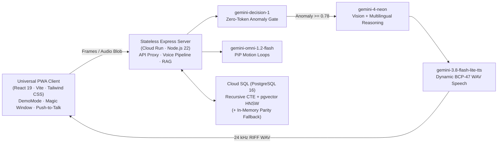

# Jack of All Trades

**Open-Source Multimodal Visual Repair & Physical Assembly Assistant (PWA)**

[](./LICENSE)
[](https://nodejs.org/)
[](https://react.dev/)
[](./schema.sql)

**Jack of All Trades** is an AGPL-3.0 Progressive Web App that turns any smartphone or tablet camera into a real-time, voice-enabled visual mechanic and assembly guide. Designed with a distraction-free **Magic Window** camera interface for non-technical users and backed by a zero-token decision routing pipeline, multilingual two-way audio, and a PostgreSQL `pgvector` physical ontology graph, it helps users identify hardware parts, follow step-by-step repair instructions, and avoid costly mistakes or unnecessary product returns.

---

## Key Capabilities

- **Magic Window Live Camera UI & Spatial AR Overlay** — Full-screen rear-facing viewfinder (`MediaDevices` API) with hardware torch/screen-fill flashlight control, **Scan Problem** + **Hold to Explain**, and a live `<SpatialRepairOverlay/>` rendering Gemini bounding boxes, animated directional SVG motion cues (`rotate_cw`, `rotate_ccw`, `slide`, `lift`, `press`, `align`), verified scale-anchor overlays, and a **View AR** sheet toggle.
- **Voice-Guided Interactive Onboarding Demo** — First-time visitors experience a safe, interactive battery-latch walkthrough with automated neural voice narration (`GET /api/demo-narration`) synchronized step-by-step with visual highlights and animated motion cues.
- **Unified Native Two-Way Multilingual Voice Assist** — Press and hold **Hold to Explain** to capture raw microphone audio (`MediaRecorder`) alongside live visual frames. Enforces the exact same Scale Anchor calibration, multi-step AR overlay, per-step PiP video clips, and Cloud SQL self-learning write-back as **Scan Problem**, while replying aloud in the user's detected language as a 24 kHz RIFF WAV stream.
- **Zero-Token Decision Routing (ADR 003)** — Client-side stillness gating and `gemini-decision-1` (`v1beta` Decisions API, `0` output tokens) filter nominal frames and escalate to `gemini-4-neon` only on high-confidence anomalies (`>= 0.78`), reducing compute cost and preventing mobile thermal throttling.
- **Pixel-Ratio Scale Anchor Guard (ADR 006 / Break 2)** — Compares target hardware against known reference dimensions (`24.26 mm` US quarter, `85.6 mm` credit card, `20 mm` thumb, or ruler), reports `estimatedPartSizeMm`, and redacts exact metric/imperial tool specs unless calibrated (or explicitly opted out with written + spoken explanation).
- **Self-Learning PostgreSQL Recursive CTE + `pgvector` Ontology RAG (ADR 001 & ADR 007)** — Every live Scan and Hold-to-Explain session automatically logs to Cloud SQL (`diagnostic_sessions`), embeds frames with `gemini-embedding-2`, learns new parts/actions, and updates live `success_rate` & `$30` return-deflection bounties when users tap **Done — This Fixed It!** or **Wrong Part or Size?**.
- **Multi-Step Repairs with On-Demand Per-Step PiP Clips (ADR 005)** — Supports multi-step guided repairs (up to 6 steps) where each step carries its own AR reticle, directional cue, and repair-only hand-motion prompt. Tapping **Show Step N Motion** generates and caches a 6-second `gemini-omni-1.2-flash` loop on demand (playable inline or in a floating corner Mini-PiP over the live camera).
- **Built-In Admin & Operations Platform (`/admin`)** — Live system health monitoring (`/api/health`), Cloud SQL diagnostics, Scale Anchor Guard tester, live Cloud SQL Ontology RAG explorer, architecture diagrams, one-click copy/download AGPL-3.0 corresponding source (`server.ts`, `server.js`, `schema.sql`, `Dockerfile`, `docs/*`), and embedded QA runbook.

---

## System Architecture



### AI Model Stack (`@google/genai`)

| Role | Model | Purpose |
| :--- | :--- | :--- |
| **Anomaly Gate** | `gemini-decision-1` | Zero-output-token parallel calibrated checks (`user_stalled`, `hazard_proximity`, `alignment_anomaly`, `visual_noise_extreme`). |
| **Multimodal Brain** | `gemini-4-neon` | Grounded visual repair diagnosis, spoken language detection, and concise same-language mechanic replies. |
| **Neural Voice** | `gemini-3.8-flash-lite-tts` | Dynamic BCP-47 speech synthesis (`24 kHz` mono 16-bit WAV) for two-way voice assist and cached onboarding narration. |
| **Motion Output** | `gemini-omni-1.2-flash` | Picture-in-Picture video loops illustrating hand motions and latch mechanisms. |
| **Embeddings** | `gemini-embedding-2` | 768-dimensional visual signature vectors for instant ontology correction lift. |

For complete Mermaid sequence diagrams, ER schemas, and Architecture Decision Records (ADR 001 – ADR 008), see [`docs/ARCHITECTURE.md`](./docs/ARCHITECTURE.md).

---

## Project Structure

```text
.
├── server.ts                  # Unified Express + Vite dev/prod backend source (TypeScript)
├── server.js                  # Compiled Cloud Run production bundle (generated from server.ts)
├── schema.sql                 # PostgreSQL 16 + pgvector schema, Recursive CTEs, Auth tables & seed data
├── Dockerfile                 # Multi-stage container (compiles server.ts -> server.js, Port 8080)
├── App.jsx                    # Standalone AGPL-3.0 reference client deliverable
├── docs/
│   ├── ARCHITECTURE.md        # System topology, sequence diagrams, ER diagram & ADRs 001–008
│   └── RUNBOOK.md             # Cloud SQL setup, Cloud Run env vars & deploy, QA matrix & RBAC rollout
├── src/
│   ├── App.tsx                # Root SPA router (DemoMode <-> LiveCameraView; isolated /admin route)
│   ├── components/
│   │   ├── DemoMode.tsx       # Voice-narrated interactive battery-latch onboarding demo
│   │   ├── LiveCameraView.tsx # Magic Window camera, Scan Problem, Hold-to-Explain & Stepper
│   │   ├── SpatialRepairOverlay.tsx # Live AR bounding boxes, directional SVG cues & Mini-PiP
│   │   ├── InstructionSheet.tsx # Compact multi-step guide, per-step PiP & Cloud SQL feedback
│   │   ├── AdminPlatform.tsx  # 4-tab Admin & Operations Console (/admin, direct URL only)
│   │   ├── AdminAuthScaffoldCard.tsx # Admin RBAC status panel & enforced-mode AdminLoginGate
│   │   ├── OntologyExplorer.tsx # Live Cloud SQL Recursive CTE hierarchy, RAG & M4/M6 feedback
│   │   ├── ArchitectureBlueprint.tsx # Interactive topology + AGPL source copy/downloader
│   │   ├── RunbookView.tsx    # QA verification launcher & embedded copyable operations runbook
│   │   └── BrandMark.tsx      # Jack of Spades holding a claw hammer brand lockup
│   └── lib/
│       ├── audioUtils.ts      # MIME normalization, BCP-47 resolver & 3-sentence cap (+ tests)
│       ├── authContext.tsx    # In-memory React Bearer token context (zero localStorage tokens)
│       ├── authScaffold.ts    # Shared RBAC roles, hierarchy & API route policy matrix (+ tests)
│       ├── serverAuth.ts      # Node scrypt hashing, HMAC-SHA256 tokens & requireAuth middleware
│       ├── dbConfig.ts        # Cloud SQL Unix socket / Public IP TLS pool resolver (+ tests)
│       ├── demoNarration.ts   # Synchronized onboarding script & visual phase mapping (+ tests)
│       ├── makerLensState.ts  # Pure onboarding, multi-step hotspot & scan reducer (+ tests)
│       ├── ontologyMapper.ts  # Gemini 0..1000 box normalizer & PG snake_case mappers (+ tests)
│       ├── scaleCalibration.ts # Pixel-ratio scale calibration & opt-out enforcement (+ tests)
│       └── routingLogic.ts    # Adaptive ingest, motion gate, Decisions gate & ontology (+ tests)
└── LICENSE                    # GNU Affero General Public License v3.0 (AGPL-3.0-only)
```

---

## Getting Started

### Prerequisites

- **Node.js** `22+` (or compatible LTS runtime)
- **npm** (or `bun`)
- **Gemini API Key** with access to the Gemini 4 model stack (`GEMINI_API_KEY`)
- *(Optional)* **PostgreSQL 16 + `pgvector`** (e.g., Google Cloud SQL) — when omitted or unreachable locally, the server automatically runs with full in-memory Recursive CTE and cosine RAG parity.

### 1. Install Dependencies

```bash
npm install
```

### 2. Configure Environment Variables

Copy `.env.example` to `.env` and populate your runtime secrets (never commit `.env` or real credentials):

```bash
cp .env.example .env
```

| Variable | Required | Description |
| :--- | :---: | :--- |
| `GEMINI_API_KEY` | Yes | Server-side Gemini 4 API key (never exposed to the client bundle). |
| `PORT` | No | HTTP listen port (`3000` for local dev, `8080` on Google Cloud Run). |
| `SQL_CONNECTION_NAME` | Optional | Cloud SQL instance connection name (`project:region:instance`). |
| `DB_HOST` / `SQL_HOST` | Optional | `/cloudsql/<connection_name>` on Cloud Run, `127.0.0.1` for local proxy, or blank for Public IP TLS. |
| `DB_NAME` / `SQL_DB_NAME` | Optional | Target PostgreSQL database name. |
| `DB_USER` / `SQL_USER` | Optional | PostgreSQL application role. |
| `DB_PASS` / `SQL_PASSWORD` | Optional | PostgreSQL password (inject via Secret Manager in production). |
| `SQL_SSL` | Optional | Enable TLS over TCP (`true` by default; disabled automatically on `/cloudsql/` Unix sockets). |
| `AUTH_ENFORCEMENT_MODE` | Optional | RBAC enforcement toggle (`scaffold` by default; set to `enforced` once login accounts are enabled). |

### 3. Run Locally

```bash
# Development server (Express API + Vite frontend on http://localhost:3000)
npm run dev

# Production bundle build
npm run build

# Start production server
npm start
```

### 4. Verify Tests, Types & Syntax

```bash
# TypeScript type checking
npm run lint

# Full pure-logic unit test suite
npx --yes tsx --test src/lib/*.test.ts

# Recompile unified Cloud Run bundle & verify syntax
npx esbuild server.ts --bundle --platform=node --format=esm --packages=external --outfile=server.js
node --check server.js
```

---

## Accessing the Admin & Operations Platform

For security isolation (**ADR 008**), the Admin & Operations Platform is **never linked or embedded** anywhere in the end-user Demo or Live Camera screens, and `?admin=1` query redirects are disabled.

- Operators access the console strictly by navigating directly to **`/admin`**.
- When `AUTH_ENFORCEMENT_MODE=enforced` is activated, `/admin` automatically displays the **Operator Sign-In** gate requiring an `admin` or `super_admin` account.

The console is organized into four tabs:

1. **Overview** — Live Gemini 4 API status, Identity & RBAC scaffold status, Cloud SQL connection diagnostics, B2B2C return-deflection metrics, guided demo & TTS test controls, and the full backend API directory.
2. **Ontology & RAG** — Interactive **Scale Anchor Guard Tester**, Recursive CTE component tree browser, vector similarity search, and instant M4/M6 correction feedback.
3. **Architecture** — End-to-end topology visualization plus one-click copy/download for `schema.sql`, `server.ts`, `server.js`, `App.jsx`, `Dockerfile`, `docs/ARCHITECTURE.md`, `docs/RUNBOOK.md`, and `LICENSE`.
4. **Runbook** — QA verification matrix (Test Cases 1–4), RBAC rollout instructions, and the embedded copyable operations runbook.

---

## Backend API Reference

| Method | Endpoint | Description |
| :--- | :--- | :--- |
| `GET` | `/api/health` | Cloud Run–safe liveness probe (`/healthz` alias locally), Gemini API key status, auth mode, and Cloud SQL transport summary. |
| `GET` | `/api/auth/session` | Inspects the active Bearer session principal and current RBAC enforcement mode (`scaffold` vs `enforced`). |
| `GET` | `/api/auth/config` | Publishes supported auth providers, role hierarchy, and API route access policies (ADR 008). |
| `POST` | `/api/auth/login` | Authenticates an end user or admin operator against `app_users` (`scrypt`) and issues a signed HMAC-SHA256 Bearer token. |
| `POST` | `/api/auth/logout` | Revokes the caller's active Bearer session token. |
| `GET` | `/api/db/status` | Live PostgreSQL 16 + `pgvector` connectivity probe (`?strict=1` returns HTTP `503` when unreachable). *(Admin RBAC)* |
| `POST` | `/api/analyze-buffer` | Runs `gemini-decision-1` gating → `gemini-4-neon` scale-calibrated multi-step diagnosis + live Cloud SQL write-back + WAV voiceover. *(End-User RBAC)* |
| `POST` | `/api/voice-assist` | Accepts recorded microphone audio + visual frames, detects spoken language, enforces Scale Anchor + multi-step AR diagnosis, logs to Cloud SQL, and returns same-language 24 kHz WAV speech. *(End-User RBAC)* |
| `POST` | `/api/speak-notice` | Synthesizes on-demand WAV voice guidance for single repair steps or scale opt-out explanations. *(End-User RBAC)* |
| `GET` | `/api/demo-narration` | Serves cached neural WAV voiceover clips (`?cue=intro\|step-1\|step-2\|step-3`) for the interactive onboarding demo. |
| `POST` | `/api/generate-pip` | Generates an on-demand 6-second per-step hand-motion PiP video loop via `gemini-omni-1.2-flash`. *(End-User RBAC)* |
| `GET` | `/api/ontology/tree` | Returns the live Cloud SQL Recursive CTE hardware assembly hierarchy, learned components, feedback log, and flywheel metrics. *(Admin RBAC)* |
| `POST` | `/api/ontology/search` | Executes `pgvector` cosine RAG search with Break 2 Scale Anchor Guard enforcement. *(Admin RBAC)* |
| `POST` | `/api/ontology/feedback` | Records end-user part/size corrections, embeds frames via `gemini-embedding-2`, and updates or creates Cloud SQL ontology nodes immediately. *(End-User RBAC)* |
| `POST` | `/api/ontology/confirm-fix` | Marks a live diagnostic session `resolved_deflected`, updates `repair_actions.success_rate`, and logs a `$30` return-deflection bounty. *(End-User RBAC)* |
| `POST` | `/api/ontology/deflection` | Logs a verified B2B2C hardware return deflection bounty from the Admin console. *(Admin RBAC)* |
| `GET` | `/api/deliverables` | Serves AGPL-3.0 Corresponding Source (`schema.sql`, `server.ts`, `server.js`, `App.jsx`, `Dockerfile`, `docs/*`, `LICENSE`) for the running revision. *(Admin RBAC)* |

---

## Deployment (Google Cloud SQL + Cloud Run)

1. **Provision Database Schema:** Apply [`schema.sql`](./schema.sql) to your PostgreSQL 16 instance (enables `pgvector`, creates Recursive CTE views/functions, and seeds the initial hardware ontology).
2. **Build Container:** Build the multi-stage image using [`Dockerfile`](./Dockerfile) (exposes port `8080`).
3. **Deploy to Cloud Run:** Attach your Cloud SQL instance via `--add-cloudsql-instances` and inject `GEMINI_API_KEY` and `SQL_PASSWORD` from **Google Secret Manager**.

Step-by-step `gcloud` commands, Cloud SQL Auth Proxy instructions, QA protocols, and incident response playbooks are documented in [`docs/RUNBOOK.md`](./docs/RUNBOOK.md).

---

## Security & Open-Source Licensing

- **Admin Isolation & RBAC Scaffold (ADR 008):** The end-user PWA contains zero links or redirects to `/admin`. Authentication tokens stay strictly in React memory (`Authorization: Bearer`, never in `localStorage`), password verification uses salted `scrypt` + constant-time comparison, and flipping `AUTH_ENFORCEMENT_MODE=enforced` activates full End-User & Admin RBAC across all protected routes.
- **Server-Side Secret Isolation:** `GEMINI_API_KEY`, database passwords, and session signing keys are strictly read on the Node.js server and are never bundled into or exposed to the browser client.
- **License (`AGPL-3.0-only`):** This project is licensed under the **GNU Affero General Public License v3.0**. See [`LICENSE`](./LICENSE) for full terms. Any modified version operated over a network must make its Corresponding Source freely available to users (exposed built-in via `/api/deliverables` and the `/admin` Architecture view).
