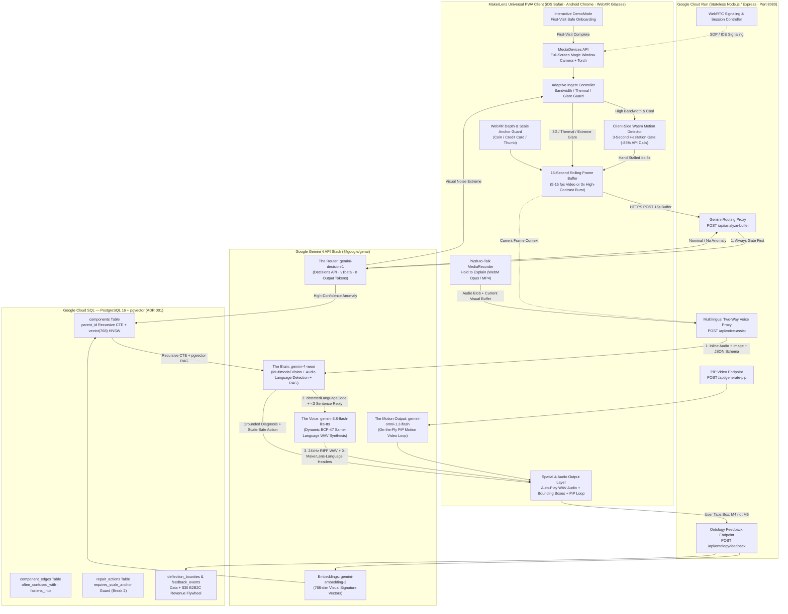
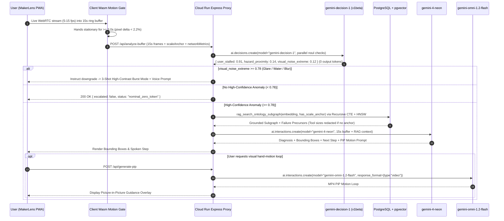
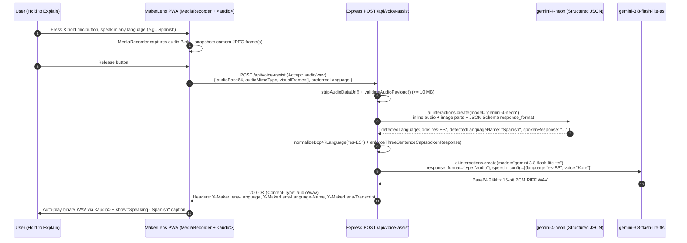
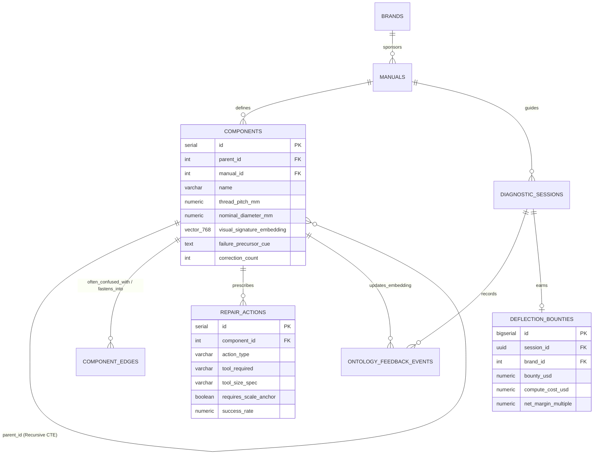
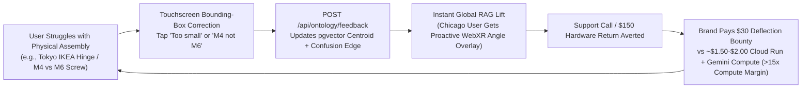

# JackOfAllTrades (MakerLens) — System Architecture Blueprint

**License:** GNU Affero General Public License v3.0 (`AGPL-3.0-only`)  
**Target Platform:** Progressive Web App (PWA) on Google Cloud Run + Cloud SQL for PostgreSQL (`pgvector`)  
**AI Stack:** Gemini Decisions API (`gemini-decision-1`) · `gemini-4-neon` · `gemini-3.8-flash-lite-tts` · `gemini-omni-1.2-flash` · `gemini-embedding-2`

---

## 1. End-to-End System Topology (ADR 001 – ADR 004)

---

## 2. Zero-Token Decision Routing & 15-Second Buffer Sequence (ADR 003 · Test Case 3)

Continuous 1080p video streaming into a heavy reasoning model causes mobile browser thermal throttling (Break 1) and excessive token spend. JackOfAllTrades gates every continuous-scan inference call through three progressively heavier tiers:

1. **Tier 0 (On-Device Wasm Motion Detector):** Computes grayscale pixel delta at 2 Hz. Stays silent while hands are actively moving; emits a trigger only after ≥3.0 seconds of stillness (hesitation) or explicit user tap.
2. **Tier 1 (`gemini-decision-1` — Zero Output Tokens):** Evaluates the 15-second ring buffer with parallel calibrated `noul` checks (`user_stalled`, `hazard_proximity`, `alignment_anomaly`, `visual_noise_extreme`). Produces `0` output tokens.
3. **Tier 2 (`gemini-4-neon` + PostgreSQL RAG):** Wakes **only** when Tier 1 crosses the high-confidence anomaly threshold (`>= 0.78`). Enforces the **Scale Anchor Invariant (Break 2)** before emitting tool sizes.

---

## 3. Native Two-Way Multilingual Voice Pipeline (ADR 004)

MakerLens enables hands-free troubleshooting in any language through the **"Hold to Explain"** push-to-talk control on the Magic Window camera UI (`LiveCameraView.tsx` / `App.jsx`). The backend (`POST /api/voice-assist` in `server.ts` and `server.js`) automatically detects the exact spoken language from the raw microphone audio and synthesizes the spoken mechanic response in that same language—never forcing English.

### Encoding, Detection & Synthesis Flow

1. **Client Capture & Base64 Packaging:** While held, `MediaRecorder` records the user's microphone using the best supported codec (`audio/webm;codecs=opus` → `audio/mp4` → `audio/ogg;codecs=opus` via `pickBestRecorderMimeType`). On release, the client converts the recorded `Blob` into a Base64 string alongside the current JPEG camera frame(s) and `preferredLanguage: navigator.language` (used **only** as a fallback if the clip contains silence or unintelligible noise).
2. **Server Validation & Normalization (`src/lib/audioUtils.ts`):** `stripAudioDataUrl` and `normalizeAudioMimeType` strip codec suffixes (e.g., `audio/webm;codecs=opus` → `audio/webm`) and `validateAudioPayload` enforces a 10 MB ceiling and minimum clip length.
3. **Multimodal Reasoning + Language Identification (`gemini-4-neon`):** Sends the inline audio part (`{ type: 'audio', data, mime_type }`) and visual frame parts (`{ type: 'image', data, mime_type }`) with `EXPERT_MECHANIC_SYSTEM_PROMPT` and a strict JSON Schema `response_format` returning:
   - `speechDetected` (boolean distinguishing audible human speech from silence/noise so silent clips never hallucinate English repairs)
   - `userTranscript` (verbatim transcript in the original spoken language to ground language detection)
   - `detectedLanguageCode` (BCP-47 tag, e.g., `es-ES`, `fr-FR`, `ja-JP`, `pt-BR`)
   - `detectedLanguageName` (human-readable label, e.g., `Spanish`, `Japanese`)
   - `spokenResponse` (direct, actionable mechanic advice in that exact language)
4. **BCP-47 Normalization & Multilingual Sentence Cap:** `normalizeBcp47Language` standardizes bare ISO-639-1 codes (`es` → `es-ES`), underscore locales (`es_MX` → `es-MX`), and script subtags (`zh-Hans-CN` → `zh-CN`). `enforceThreeSentenceCap` strips markdown and limits output to ≤3 sentences across Latin, CJK (`。！？`), Arabic (`؟`), and Devanagari (`।`) scripts.
5. **Same-Language Speech Synthesis (`gemini-3.8-flash-lite-tts`):** Invokes `ai.interactions.create` with `response_format: { type: 'audio' }` and `generation_config: { speech_config: [{ language: detectedLanguageCode, voice: 'Kore' }] }`, yielding a 24 kHz mono 16-bit RIFF WAV buffer.
6. **Binary Audio Streaming & Playback:** When the client sends `Accept: audio/wav`, Express pipes the binary WAV directly back with metadata headers (`X-MakerLens-Language`, `X-MakerLens-Language-Name`, `X-MakerLens-Transcript`). The PWA wraps the binary `Blob` in `URL.createObjectURL(...)`, auto-plays it through a hidden `<audio>` element, and displays a concise caption showing the detected language.

---

## 4. PostgreSQL Recursive CTE & `pgvector` Ontology Schema (ADR 001)

---

## 5. Data & B2B2C Revenue Flywheel (PRD §3)

---

## 6. Architecture Decision Records & Engineering Mitigations

| ID | Architectural Problem | Adopted Design | Verification Standard |
| :--- | :--- | :--- | :--- |
| **ADR 001** | Graph traversal + multimodal RAG without Neo4j or stateful SQLite volumes | PostgreSQL 16 with Recursive CTEs (`WITH RECURSIVE`) and `pgvector` HNSW cosine indexes; dual-transport Cloud SQL resolver (`SQL_*` and `DB_*` aliases, `/cloudsql/` socket presence check + Public IP TLS fallback) | `schema.sql` functions `get_component_hierarchy` & `rag_search_ontology_subgraph`; unit tests (`dbConfig.test.ts`) |
| **ADR 002** | Scale-to-zero serverless hosting for WebRTC signaling + API proxy | Stateless Node.js/Express + Vite PWA container on Google Cloud Run (`PORT=8080`, `PORT=3000` dev) | `Dockerfile` multi-stage build + `/healthz` & `/api/db/status` probes |
| **ADR 003 / Break 1** | Continuous 1080p streaming caused iPhone Safari thermal dimming & API bloat | Client-side Wasm motion gate (3s stillness) → zero-token `gemini-decision-1` → conditional `gemini-4-neon` | QA Test Case 3 + unit tests (`routingLogic.test.ts`) |
| **ADR 004** | Hands-free voice queries from global users require same-language spoken mechanic guidance without forcing English | Two-stage pipeline at `POST /api/voice-assist`: `gemini-4-neon` structured JSON language detection + <3-sentence same-language reply → `normalizeBcp47Language` → `gemini-3.8-flash-lite-tts` (`response_format: { type: 'audio' }`, dynamic `speech_config.language`) returning binary 24 kHz RIFF WAV | QA Test Case 4 (live non-English audio round-trip) + unit tests (`audioUtils.test.ts`) |
| **Break 2** | "Scale" hallucination recommending a pipe wrench for a 2mm screw | Mandatory WebXR depth or physical scale anchor (coin, credit card, thumb) enforced in both SQL and server response guard | `enforceScaleAnchorInvariant()` + `requires_scale_anchor` SQL check |
| **Hardest Input** | Water-smeared lens + chrome glare + spraying water under a kitchen sink | Automatic downgrade from WebRTC video to 3-shot high-contrast burst photography + voice instruction | QA Test Case 1 (3G throttling / visual noise fallback) |
| **UX Accessibility** | Technical camera telemetry overwhelms non-technical DIY users | Full-screen **Magic Window** UI (`LiveCameraView.tsx`) with only Scan, Push-to-Talk, and Flashlight controls + first-visit interactive `<DemoMode/>` | Unit tests (`makerLensState.test.ts`) + browser verification |

