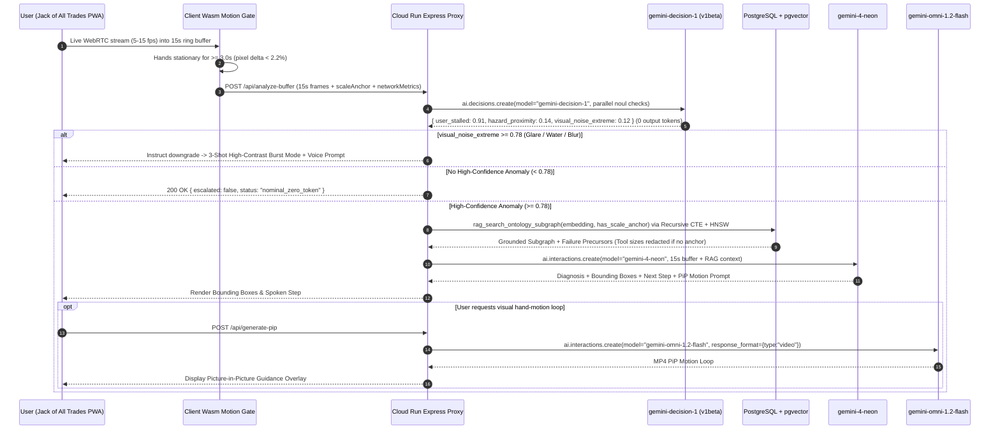
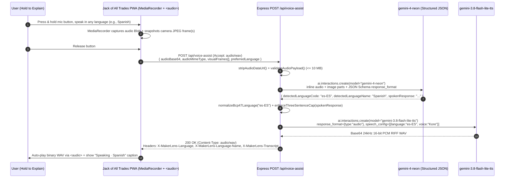
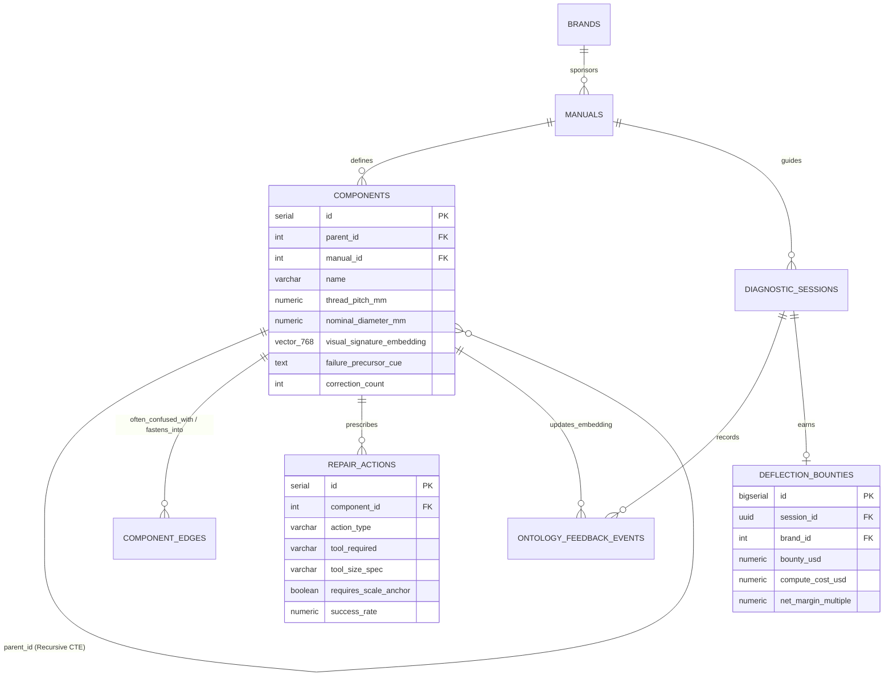
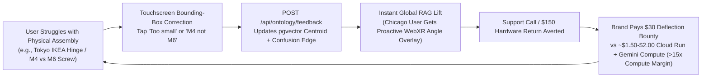
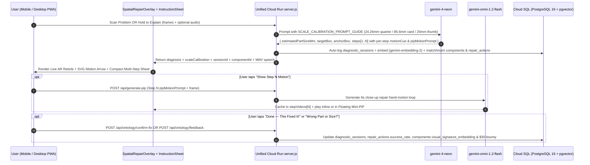
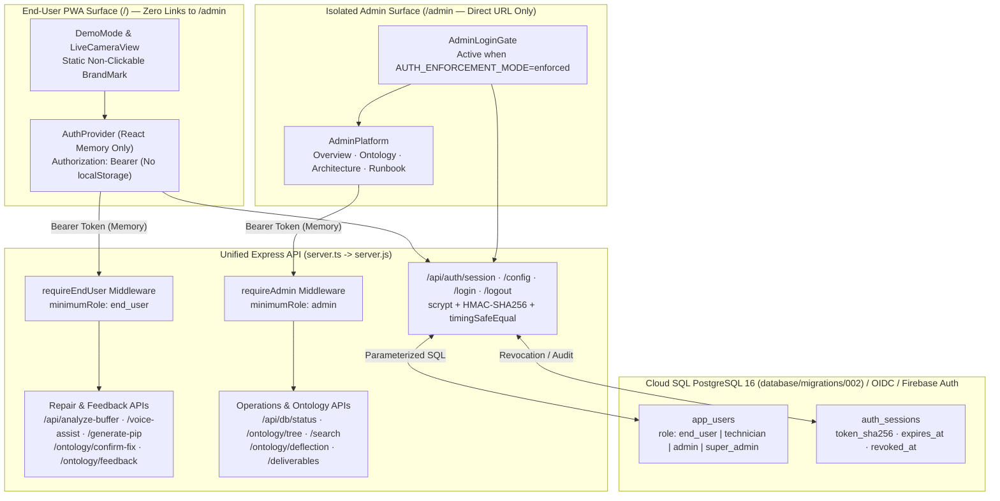
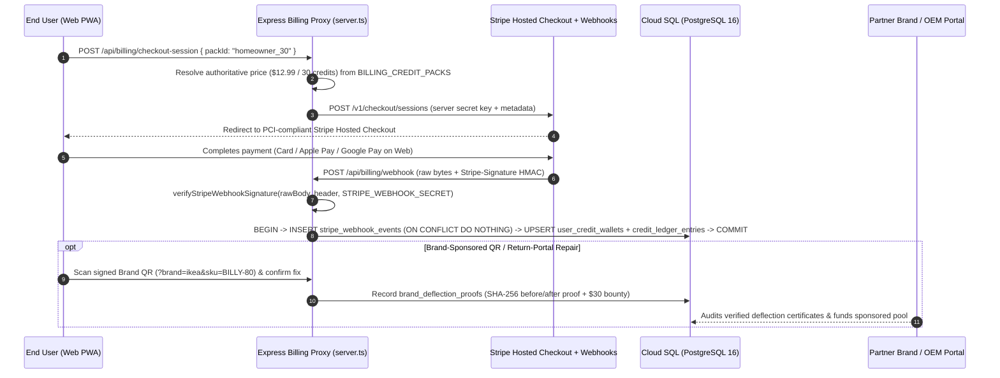

# Jack of All Trades — System Architecture Blueprint

**License:** GNU Affero General Public License v3.0 (`AGPL-3.0-only`)  
**Brand Mark:** Jack of Spades playing card emblem with the Jack holding a claw hammer (`BrandMark.tsx` / `public/icon.svg`)  
**Target Platform:** Progressive Web App (PWA) on Google Cloud Run + Cloud SQL for PostgreSQL (`pgvector`)  
**AI Stack:** Gemini Decisions API (`gemini-decision-1`) · `gemini-4-neon` · `gemini-3.8-flash-lite-tts` · `gemini-omni-1.2-flash` · `gemini-embedding-2`

---

## 1. End-to-End System Topology (ADR 001 – ADR 009)

---

## 2. Zero-Token Decision Routing & 15-Second Buffer Sequence (ADR 003 · Test Case 3)

Continuous 1080p video streaming into a heavy reasoning model causes mobile browser thermal throttling (Break 1) and excessive token spend. Jack of All Trades gates every continuous-scan inference call through three progressively heavier tiers:

1. **Tier 0 (On-Device Wasm Motion Detector):** Computes grayscale pixel delta at 2 Hz. Stays silent while hands are actively moving; emits a trigger only after ≥3.0 seconds of stillness (hesitation) or explicit user tap.
2. **Tier 1 (`gemini-decision-1` — Zero Output Tokens):** Evaluates the 15-second ring buffer with parallel calibrated `noul` checks (`user_stalled`, `hazard_proximity`, `alignment_anomaly`, `visual_noise_extreme`). Produces `0` output tokens.
3. **Tier 2 (`gemini-4-neon` + PostgreSQL RAG):** Wakes **only** when Tier 1 crosses the high-confidence anomaly threshold (`>= 0.78`). Enforces the **Scale Anchor Invariant (Break 2)** before emitting tool sizes.

---

## 3. Native Two-Way Multilingual Voice Pipeline (ADR 004)

Jack of All Trades enables hands-free troubleshooting in any language through the **"Hold to Explain"** push-to-talk control on the Magic Window camera UI (`LiveCameraView.tsx` / `App.jsx`). The backend (`POST /api/voice-assist` in `server.ts` and `server.js`) automatically detects the exact spoken language from the raw microphone audio and synthesizes the spoken mechanic response in that same language—never forcing English.

### Encoding, Detection & Synthesis Flow

1. **Client Capture & Base64 Packaging:** While held, `MediaRecorder` records the user's microphone using the best supported codec (`audio/webm;codecs=opus` → `audio/mp4` → `audio/ogg;codecs=opus` via `pickBestRecorderMimeType`). On release, the client converts the recorded `Blob` into a Base64 string alongside the current JPEG camera frame(s) and `preferredLanguage: navigator.language` (used **only** as a fallback if the clip contains silence or unintelligible noise).
2. **Server Validation & Normalization (`src/lib/audioUtils.ts`):** `stripAudioDataUrl` and `normalizeAudioMimeType` strip codec suffixes (e.g., `audio/webm;codecs=opus` → `audio/webm`) and `validateAudioPayload` enforces a 10 MB ceiling and minimum clip length.
3. **Multimodal Reasoning + Language Identification (`gemini-4-neon`):** Sends the inline audio part (`{ type: 'audio', data, mime_type }`) and visual frame parts (`{ type: 'image', data, mime_type }`) with `EXPERT_MECHANIC_SYSTEM_PROMPT` and a strict JSON Schema `response_format` returning:
   - `speechDetected` (boolean distinguishing audible human speech from silence/noise so silent clips never hallucinate English repairs)
   - `userTranscript` (verbatim transcript in the original spoken language to ground language detection)
   - `detectedLanguageCode` (BCP-47 tag, e.g., `es-ES`, `fr-FR`, `ja-JP`, `pt-BR`)
   - `detectedLanguageName` (human-readable label, e.g., `Spanish`, `Japanese`)
   - `spokenResponse` (direct, actionable mechanic advice in that exact language)
4. **BCP-47 Normalization & Multilingual Sentence Cap:** `normalizeBcp47Language` standardizes bare ISO-639-1 codes (`es` → `es-ES`), underscore locales (`es_MX` → `es-MX`), and script subtags (`zh-Hans-CN` → `zh-CN`). `enforceThreeSentenceCap` strips markdown and limits output to ≤3 sentences across Latin, CJK (`。！？`), Arabic (`؟`), and Devanagari (`।`) scripts.
5. **Same-Language Speech Synthesis (`gemini-3.8-flash-lite-tts`):** Invokes `ai.interactions.create` with `response_format: { type: 'audio' }` and `generation_config: { speech_config: [{ language: detectedLanguageCode, voice: 'Kore' }] }`, yielding a 24 kHz mono 16-bit RIFF WAV buffer.
6. **Binary Audio Streaming & Playback:** When the client sends `Accept: audio/wav`, Express pipes the binary WAV directly back with metadata headers (`X-MakerLens-Language`, `X-MakerLens-Language-Name`, `X-MakerLens-Transcript`). The PWA wraps the binary `Blob` in `URL.createObjectURL(...)`, auto-plays it through a hidden `<audio>` element, and displays a concise caption showing the detected language.

---

## 4. PostgreSQL Recursive CTE & `pgvector` Ontology Schema (ADR 001)

---

## 5. Data & B2B2C Revenue Flywheel (PRD §3)

---

## 6. Multi-Step Repair State Machine, Scale Ratio AR Overlay & Per-Step PiP (ADR 005 & ADR 006)

Real-world hardware fixes frequently require 2–6 sequential physical operations (for example: releasing a locking clip, removing two mounting bolts, sliding a cover, and reseating a seal). Pre-generating `N` video clips upfront would add unacceptable latency and compute cost, while showing only a static bottom sheet obscures the live camera.

### Adopted Design
1. **Unified Structured Multi-Step Diagnosis (Scan Problem + Hold to Explain):** Both `POST /api/analyze-buffer` and `POST /api/voice-assist` instruct `gemini-4-neon` with `SCALE_CALIBRATION_PROMPT_GUIDE` (US Quarter `24.26 mm`, Credit Card `85.60 mm × 53.98 mm`, Adult Thumb `20.0 mm`, or ruler) to return:
   - `estimatedPartSizeMm` & `scaleMeasurementNote` proving pixel-ratio comparison against the visible anchor.
   - `targetBox` & `anchorBox` in normalized `0..1000` `[ymin, xmin, ymax, xmax]` coordinates (mapped via `normalizeBoxToPct()`).
   - Ordered `steps[]` (up to 6 steps), each carrying its own `title`, `detail`, `motionCue` (`rotate_cw`, `rotate_ccw`, `slide`, `lift`, `press`, `align`, `inspect`), optional step-specific `targetBox`, `toolNeeded`, and dedicated `pipMotionPrompt`.
2. **Strict No-Coin-Placement PiP Invariant:** `pipMotionPrompt` is validated both in the prompt and inside `buildHotspotFromDiagnosis()` so PiP videos **always** demonstrate the physical repair hand motion for the active step—never generic coin placement.
3. **On-Demand Per-Step PiP Video Caching:** When the user taps **Show Step N Motion**, the client calls `POST /api/generate-pip` using only that step's `pipMotionPrompt` + reference camera frame and caches the resulting video URL in `stepVideos[stepNumber]` (`Record<number, string>`). Switching back to an earlier step replays instantaneously with zero extra API calls.
4. **Live Spatial AR Overlay + Floating Mini-PiP (`SpatialRepairOverlay.tsx`):**
   - Renders the active step's corner-bracketed AR reticle + animated SVG directional motion cue directly on top of the live camera feed (`z-20`), plus a dashed emerald **Scale Anchor Verified Box** when calibrated.
   - `InstructionSheet` stays compact (`max-h-[56dvh]`) and provides a **View AR** toggle so the user can collapse the sheet into a slim step switcher bar while keeping the live AR reticle and a floating corner **Mini-PiP** video window pinned over the camera.

---

## 7. Authentication, RBAC & Admin Isolation Scaffold (ADR 008)

Exposing the Admin & Operations Platform through a clickable logo or query parameter in the public end-user PWA creates an unnecessary privilege-discovery and unauthorized-access surface. Jack of All Trades enforces strict UI isolation immediately and scaffolds full Role-Based Access Control (RBAC) for both **End Users** (`end_user`, `technician`) and **Admin Operators** (`admin`, `super_admin`) so secure sign-in can be activated with zero schema or route refactoring.

### Security Boundaries & Scaffold Components
1. **Zero In-App Admin Links (Immediate Isolation):**
   - `DemoMode.tsx` and `LiveCameraView.tsx` render `<BrandMark />` as a strictly non-interactive `
` with zero `onClick` handlers or admin routes.
   - `src/App.tsx` restricts `isAdminLocation()` strictly to `/admin` and `/admin/*` (removing `?admin=1` query-string triggers). Operators access `/admin` directly by URL.
2. **Shared Role Hierarchy & Route Policy Matrix (`src/lib/authScaffold.ts`):**
   - Browser-safe contract defining `UserRole` (`anonymous < end_user < technician < admin < super_admin`), `hasRequiredRole()`, `resolveAuthEnforcementMode()`, and `ROUTE_ACCESS_POLICIES` partitioning public probes, end-user repair APIs (`/api/analyze-buffer`, `/api/voice-assist`, `/api/generate-pip`, `/api/ontology/confirm-fix`, `/api/ontology/feedback`), and admin APIs (`/api/db/status`, `/api/ontology/tree`, `/api/ontology/search`, `/api/ontology/deflection`, `/api/deliverables`).
3. **Server-Side Cryptographic & Middleware Scaffold (`src/lib/serverAuth.ts` + `server.ts`):**
   - Uses Node.js native `crypto.scryptSync` (16-byte random salt) + `crypto.timingSafeEqual` for password hashing/verification, and compact HMAC-SHA256 Bearer tokens (`signSessionToken` / `verifySessionToken`) signed with `process.env.AUTH_SESSION_SECRET` (falling back to an ephemeral 32-byte process key when unset).
   - `createRequireAuthMiddleware(minimumRole)` is mounted on every end-user (`requireEndUser`) and admin (`requireAdmin`) API route. In `AUTH_ENFORCEMENT_MODE=scaffold` (default prior to login rollout), it attaches verified `req.authPrincipal` without interrupting workflows; flipping `AUTH_ENFORCEMENT_MODE=enforced` immediately enforces HTTP `401` (missing/invalid/revoked Bearer token) and `403` (insufficient role).
   - Exposes `/api/auth/session`, `/api/auth/config`, `/api/auth/login` (parameterized Cloud SQL `app_users` lookup), and `/api/auth/logout` (token revocation).
4. **In-Memory Client Token Boundary (`src/lib/authContext.tsx` + `src/components/AdminAuthScaffoldCard.tsx`):**
   - `AuthProvider` stores any active `Authorization: Bearer` token strictly in React memory (`useRef`)—never in `localStorage` or `sessionStorage`.
   - When `AUTH_ENFORCEMENT_MODE=enforced` is enabled, `/admin` automatically renders `<AdminLoginGate />` until an operator authenticates with `admin` or `super_admin` privileges.
5. **Cloud SQL Identity Schema (`database/migrations/002_auth_and_rbac.sql`):**
   - Idempotent PostgreSQL 16 `app_users` (`email`, `role`, `auth_provider` supporting `email_password_scrypt`, `oidc_google`, `firebase_auth`, `external_sub`, `password_hash`, `is_active`), `auth_sessions` (`token_sha256`, `role_snapshot`, `expires_at`, `revoked_at` — persisted and checked across Cloud Run instances), and `diagnostic_sessions.user_id` foreign key linking repairs to end-user accounts.

---

## 8. Stripe Payments, Credit Ledger & B2B2C Proof-of-Deflection Scaffold (ADR 009)

Operating a multimodal Gemini 4 repair assistant without frontend usage caps creates an unbounded inference cost liability ("blank check"), while B2B2C brand bounties require tamper-evident proof tying completed repairs to specific OEM SKUs and deflected support interactions. Jack of All Trades solves both through a **dual-rail hybrid monetization scaffold**:

1. **Frontend Pay-As-You-Go Repair Credits (Web PWA + Stripe Hosted Checkout):**
   - Because Jack of All Trades ships as an installable Web PWA, routing payments through **Stripe Hosted Checkout** avoids 15%–30% native app-store commissions (~2.9% + $0.30 Stripe fee) and eliminates subscription fatigue for episodic DIY users.
   - New accounts receive `2` free starter credits (`DEFAULT_STARTER_CREDITS`), Demo Mode costs `0` credits (cached WAVs), `Scan Problem` and `Hold to Explain` cost `1` credit each, and on-demand 6-second PiP clips (`gemini-omni-1.2-flash`) cost `2` credits.
   - Clients submit only a `packId` (`starter_10`, `homeowner_30`, `pro_pack_100`, or optional `pro_unlimited_monthly`) to `POST /api/billing/checkout-session`; the Express server resolves all prices and credit grants strictly from `BILLING_CREDIT_PACKS`.
   - `POST /api/billing/webhook` verifies Stripe's `Stripe-Signature` HMAC-SHA256 header against exact raw request bytes (`crypto.timingSafeEqual`, 300s replay tolerance) and credits `user_credit_wallets` + `credit_ledger_entries` inside an atomic, idempotent PostgreSQL transaction deduplicated by `stripe_webhook_events(stripe_event_id)`.
   - Controlled by `BILLING_ENFORCEMENT_MODE` (`scaffold` default → `enforced` returns HTTP `402 Payment Required` when credits reach `0`).
2. **Backend B2B2C Verifiable Proof-of-Deflection (`brand_deflection_proofs`):**
   - Connects repairs directly to OEMs via four attribution channels: **Signed QR on Box/Manual** (`brand_qr_box`), **Support / Return Portal Deflection Links** (`support_portal_redirect`), **UPC/Rating-Plate Barcode Scans** (`barcode_sku_scan`), and **Before/After Visual Verification Certificates** (`organic_camera`).
   - Each verified repair generates a deterministic SHA-256 certificate digest (`buildDeflectionProofHash`) persisted in `brand_deflection_proofs`. Participating brands fund prepaid sponsored credit pools so their customers repair for free while the OEM receives auditable deflection receipts.

---

## 9. Architecture Decision Records & Engineering Mitigations

| ID | Architectural Problem | Adopted Design | Verification Standard |
| :--- | :--- | :--- | :--- |
| **ADR 001** | Graph traversal + multimodal RAG without Neo4j or stateful SQLite volumes | PostgreSQL 16 with Recursive CTEs (`WITH RECURSIVE`) and `pgvector` HNSW cosine indexes; dual-transport Cloud SQL resolver (`SQL_*` and `DB_*` aliases, `/cloudsql/` socket presence check + Public IP TLS fallback) | `database/migrations/001_initial_ontology_schema.sql` functions `get_component_hierarchy` & `rag_search_ontology_subgraph`; unit tests (`dbConfig.test.ts`, `ontologyMapper.test.ts`) |
| **ADR 002** | Scale-to-zero serverless hosting & drift between dev `server.ts` and Cloud Run `server.js` | Single source of truth in `server.ts`, compiled by `esbuild` directly into `server.js` (ESM) in `Dockerfile` and repo so dev, Cloud Run, and `node server.js` expose identical routes (`/api/health`, `/api/ontology/*`, `/api/deliverables`) | `Dockerfile` multi-stage build + production `node server.js` smoke test |
| **ADR 003 / Break 1** | Continuous 1080p streaming caused iPhone Safari thermal dimming & API bloat | Client-side Wasm motion gate (3s stillness) → zero-token `gemini-decision-1` → conditional `gemini-4-neon` | QA Test Case 3 + unit tests (`routingLogic.test.ts`) |
| **ADR 004** | Hands-free voice queries from global users require same-language spoken mechanic guidance without forcing English | Two-stage pipeline at `POST /api/voice-assist`: `gemini-4-neon` structured JSON language detection + Scale Calibration + multi-step diagnosis → `normalizeBcp47Language` → `gemini-3.8-flash-lite-tts` returning binary 24 kHz RIFF WAV + structured repair guide | QA Test Case 4 + unit tests (`audioUtils.test.ts`, `scaleCalibration.test.ts`) |
| **ADR 005** | Multi-step repairs need visual hand-motion guidance without pre-generating N expensive PiP videos upfront | Per-step `pipMotionPrompt` + `motionCue` + `targetBox` returned in `steps[]`; client generates 6s `gemini-omni-1.2-flash` clips strictly on demand per step and caches them in `stepVideos[stepNumber]` with a floating Mini-PiP window | Unit tests (`makerLensState.test.ts`) + live browser stepper verification |
| **ADR 006 / Break 2** | "Scale" hallucination & hidden AR overlays covered by tall bottom sheets | Pixel-ratio measurement prompt (`24.26 mm` US quarter, `85.6 mm` card, `20 mm` thumb) returning `estimatedPartSizeMm`, `scaleMeasurementNote`, `targetBox`, and `anchorBox`, rendered via `<SpatialRepairOverlay/>` with animated directional SVG arrows and a compact sheet + **View AR** toggle | `resolveScaleCalibration()`, `normalizeBoxToPct()`, `SpatialRepairOverlay.tsx` |
| **ADR 007** | Admin Ontology stayed static unless operators manually inserted rows | Automatic Cloud SQL write-back (`recordLiveDiagnosisToCloudSql`) logging every live Scan & Voice session, embedding frames via `gemini-embedding-2`, auto-inserting newly discovered parts, plus in-camera **Done — This Fixed It!** (`POST /api/ontology/confirm-fix`) and **Wrong Part or Size?** (`POST /api/ontology/feedback`) | `ontologyMapper.test.ts` + live `/api/ontology/tree` PostgreSQL verification |
| **ADR 008** | Clickable brand logo in end-user PWA exposed `/admin` directly to end users; dual-audience login needed a clean security foundation | Removed all in-app admin links and `?admin=1` triggers; isolated `/admin` to direct URL access; added RBAC role/policy contract (`authScaffold.ts`), salted `scrypt` + HMAC-SHA256 middleware (`serverAuth.ts`), in-memory React `AuthProvider`, Cloud SQL `app_users`/`auth_sessions` schema, and enforced-mode `<AdminLoginGate />` | Unit tests (`authScaffold.test.ts`) + DOM isolation check + `401`/`403` middleware verification |
| **ADR 009** | Unbounded free AI inference creates a blank-check cost risk, and B2B2C brands need auditable proof of deflected calls/returns | Web PWA Stripe Hosted Checkout pay-as-you-go credit packs (`billingScaffold.ts`), raw-body HMAC webhook verification (`serverStripe.ts`), provider-agnostic Cloud SQL credit ledger (`user_credit_wallets`, `credit_ledger_entries`, `stripe_webhook_events`), and tamper-evident `brand_deflection_proofs` certificates | Unit tests (`stripeBilling.test.ts`) + `/api/billing/*` smoke verification |
| **Hardest Input** | Water-smeared lens + chrome glare + spraying water under a kitchen sink | Automatic downgrade from WebRTC video to 3-shot high-contrast burst photography + voice instruction | QA Test Case 1 (3G throttling / visual noise fallback) |
| **UX Accessibility** | Technical camera telemetry overwhelms non-technical DIY users | Full-screen **Magic Window** UI (`LiveCameraView.tsx`) with only Scan, Push-to-Talk, and Flashlight controls + first-visit interactive `<DemoMode/>` | Unit tests (`makerLensState.test.ts`) + browser verification |

