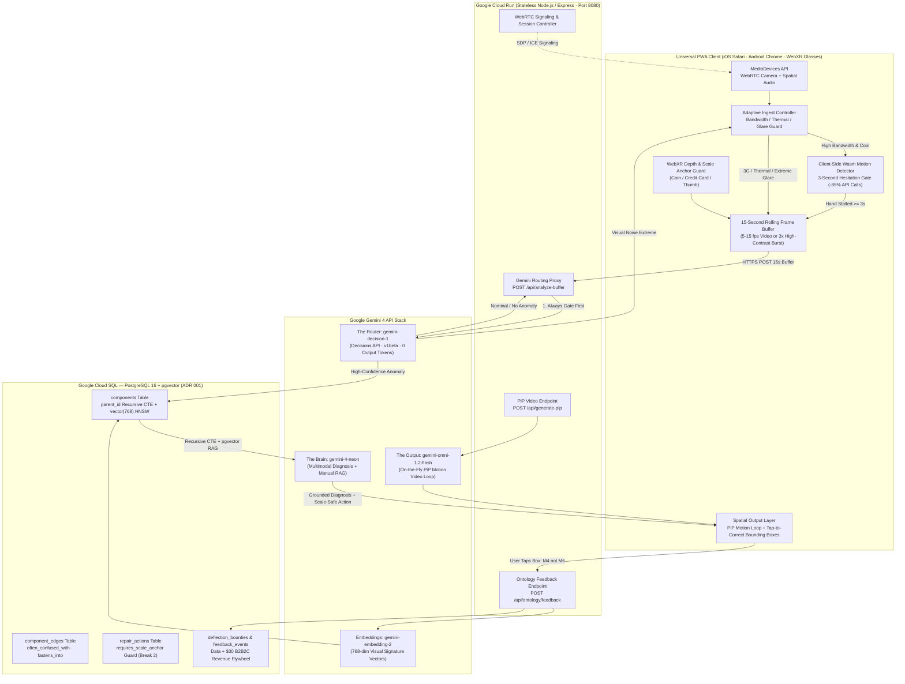
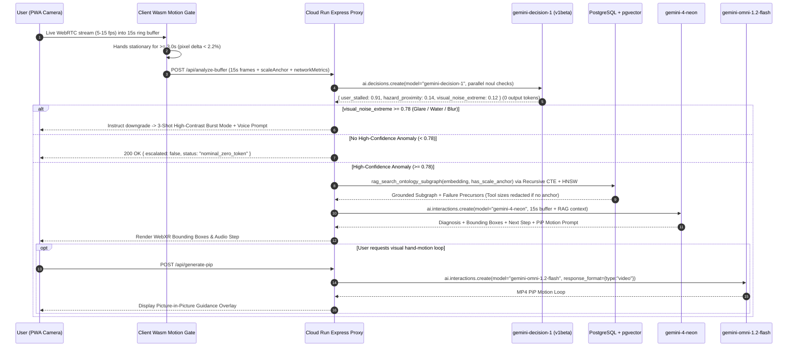
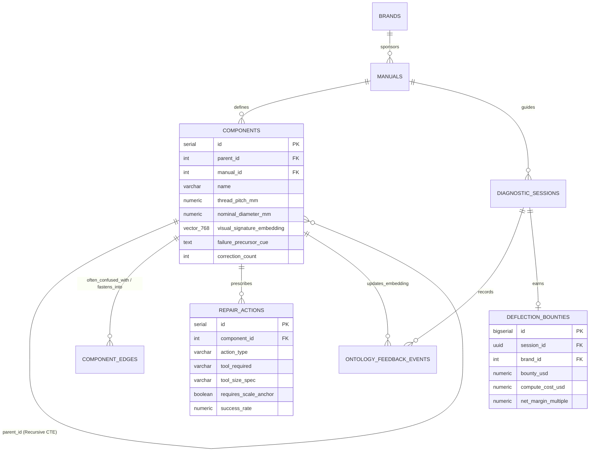
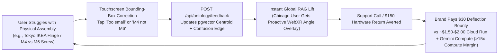

# JackOfAllTrades — System Architecture Blueprint

**License:** GNU Affero General Public License v3.0 (`AGPL-3.0-only`)  
**Target Platform:** Progressive Web App (PWA) on Google Cloud Run + Cloud SQL for PostgreSQL (`pgvector`)  
**AI Stack:** Gemini Decisions API (`gemini-decision-1`) · `gemini-4-neon` · `gemini-omni-1.2-flash` · `gemini-embedding-2`

---

## 1. End-to-End System Topology (ADR 001, ADR 002, ADR 003)

---

## 2. Zero-Token Decision Routing & 15-Second Buffer Sequence (ADR 003 · Test Case 3)

Continuous 1080p video streaming into a heavy reasoning model causes mobile browser thermal throttling (Break 1) and excessive token spend. JackOfAllTrades gates every inference call through three progressively heavier tiers:

1. **Tier 0 (On-Device Wasm Motion Detector):** Computes grayscale pixel delta at 2 Hz. Stays silent while hands are actively moving; emits a trigger only after ≥3.0 seconds of stillness (hesitation) or explicit user tap.
2. **Tier 1 (`gemini-decision-1` — Zero Output Tokens):** Evaluates the 15-second ring buffer with parallel calibrated `noul` checks (`user_stalled`, `hazard_proximity`, `alignment_anomaly`, `visual_noise_extreme`). Produces `0` output tokens.
3. **Tier 2 (`gemini-4-neon` + PostgreSQL RAG):** Wakes **only** when Tier 1 crosses the high-confidence anomaly threshold (`>= 0.78`). Enforces the **Scale Anchor Invariant (Break 2)** before emitting tool sizes.

---

## 3. PostgreSQL Recursive CTE & `pgvector` Ontology Schema (ADR 001)

---

## 4. Data & B2B2C Revenue Flywheel (PRD §3)

---

## 5. Architecture Decision Records & Engineering Mitigations

| ID | Architectural Problem | Adopted Design | Verification Standard |
| :--- | :--- | :--- | :--- |
| **ADR 001** | Graph traversal + multimodal RAG without Neo4j or stateful SQLite volumes | PostgreSQL 16 with Recursive CTEs (`WITH RECURSIVE`) and `pgvector` HNSW cosine indexes | `schema.sql` functions `get_component_hierarchy` & `rag_search_ontology_subgraph` |
| **ADR 002** | Scale-to-zero serverless hosting for WebRTC signaling + API proxy | Stateless Node.js/Express + Vite PWA container on Google Cloud Run (`PORT=8080`) | `Dockerfile` multi-stage build + `/healthz` probe |
| **ADR 003 / Break 1** | Continuous 1080p streaming caused iPhone Safari thermal dimming & API bloat | Client-side Wasm motion gate (3s stillness) → zero-token `gemini-decision-1` → conditional `gemini-4-neon` | QA Test Case 3 + unit tests (`routingLogic.test.ts`) |
| **Break 2** | "Scale" hallucination recommending a pipe wrench for a 2mm screw | Mandatory WebXR depth or physical scale anchor (coin, credit card, thumb) enforced in both SQL and server response guard | `enforceScaleAnchorInvariant()` + `requires_scale_anchor` SQL check |
| **Hardest Input** | Water-smeared lens + chrome glare + spraying water under a kitchen sink | Automatic downgrade from WebRTC video to 3-shot high-contrast burst photography + voice instruction | QA Test Case 1 (3G throttling / visual noise fallback) |
